# Práctica 1 – Middleware (YARP)

  **Repositorio:** `<!-- TODO: PENDIENTE DE AÑADIT -->`

## Configuración adicional en el entorno

La práctica recomienda lanzar el contenedor con `docker run --rm`, lo que borra el contenedor (y todo lo que hayas hecho dentro) al salir. Antes de empezar quise tener una carpeta permanente donde guardar el código y los resultados sin perderlos. Esto es lo que investigué:

1. Con `--rm` todo lo escrito dentro del contenedor desaparece al cerrarlo, así que busqué cómo conservar una carpeta de trabajo.
2. Docker permite montar una carpeta del host dentro del contenedor (denominado bind mount) con `-v ruta_host:ruta_contenedor`.
3. Verifiqué que `/workspace` en el contenedor era la misma carpeta que había enlazado en el host (`WorkingFolder`).
4. Al intentar editar la carpeta enlazada desde el contenedor, el sistema me lo impedía:

   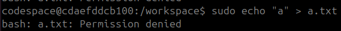

5. Probé a lanzar el contenedor con mi propio usuario (`--user "$(id -u):$(id -g)"`). Puesto que el contenedor no conoce ese UID, el sistema estaba trabajando sin usuario, A parte del trauma visual, supuse que esto podía interferir en el correcto funcionamiento del contenedor por lo que busqué otra manera.

   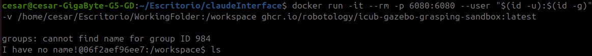

6. Como los permisos se asignan por UID, mi usuario (`cesar`) es el 1000, pero el usuario `codespace` de la imagen es el 33333, y la carpeta del host no le concedía acceso. La solución fue darle permisos explícitos con ACL (`setfacl`), incluyendo la ACL por defecto para que los ficheros nuevos hereden el permiso:

   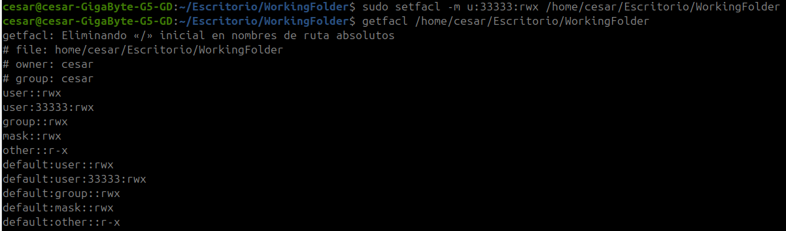

7. Con eso ya se puede leer y escribir desde el contenedor. El comando final queda así:

   docker run -it --rm -p 6080:6080 --user codespace -v /home/cesar/Escritorio/WorkingFolder:/workspace ghcr.io/robotology/icub-gazebo-grasping-sandbox:latest

### ¿Por qué esta solución y no un `docker cp` al final?

Aunque no es una diferencia dramática, por preferencia personal me quedo con esta forma de trabajar ya que me parece más natural trabajar simplemente desde esa carpeta, guardándose en el host en tiempo real. No hay que acordarse de copiar nada y, si el contenedor falla o se cierra (con `--rm` ya no se puede hacer `docker cp`), no se pierde trabajo. Además, puedo editar desde el IDE del host y ejecutar dentro del contenedor sobre los mismos archivos, que ya quedan listos para `git` y para el zip de Moodle.

## Ejercicio 1: Comandos básicos de YARP en la línea de comandos

### 1. Verificar el entorno de YARP

* **`yarp check`**: ejecuta un diagnóstico del entorno: comprueba la instalación, la red y si el servidor de nombres es alcanzable, y hace una prueba de comunicación entre puertos.

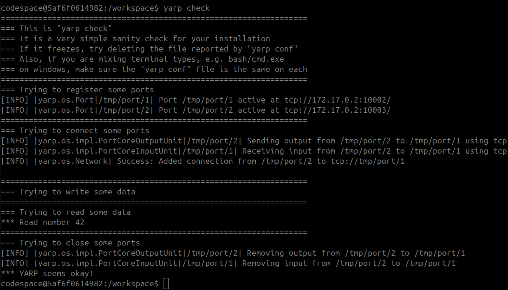

* **`yarp conf <hostname> <port>`**: guarda en la configuración local la dirección (IP y puerto) del servidor de nombres al que se conectarán los programas YARP de esa máquina.

### 2. Iniciar y verificar el servidor de nombres

* **`yarpserver`**: arranca el servidor de nombres, que registra los puertos y resuelve dónde está cada uno para poder conectarlos. Podemos acceder a la interfaz usando la dirección y puerto donde se ha levantado el servicio.
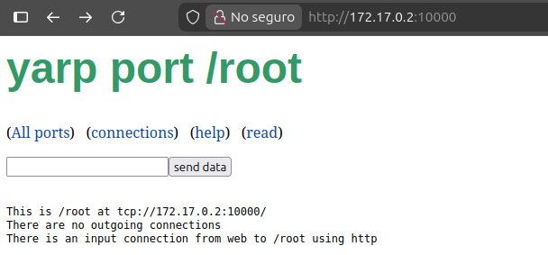

* **`yarp where`**: muestra dónde está el servidor de nombres que se está usando (IP y puerto). Como el servidor está levantado en otra sesion del contenedor, al ejecutar el comando en un nuevo terminal, detecta esta localización, Nótese que coincide con la IP y puerto donde se levantó el servicio.
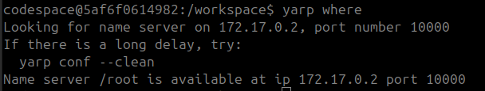

### 3. Crear y manipular puertos

* **`yarp write /example/writer`**: crea un puerto de escritura y envía a través de él lo que se escribe por teclado.
* **`yarp read /example/reader`**: crea un puerto de lectura que imprime en la terminal lo que recibe.
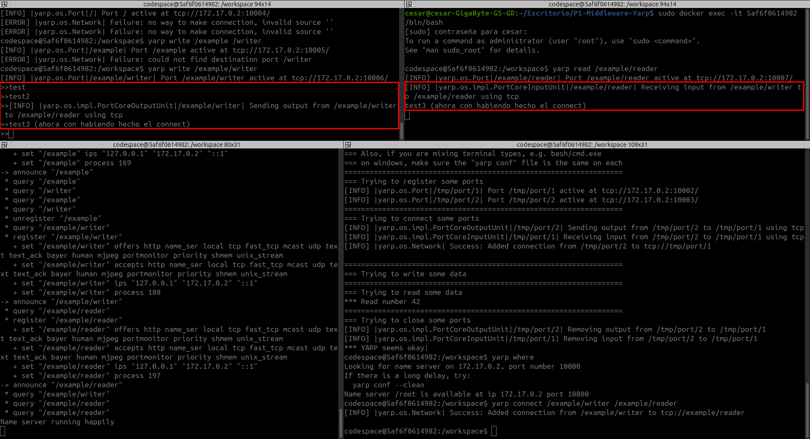

* **`yarp connect /example/writer /example/reader`**: conecta un puerto de salida con uno de entrada, de modo que lo escrito en el primero llega al segundo. Nótese que sin esto, los mensajes enviados por el writer no llegarán al reader.
* **`yarp disconnect /example/writer /example/reader`**: elimina esa conexión, sin cerrar los puertos.
* **`yarp name list`**: lista los puertos registrados en el servidor de nombres. Nótese que se puede apreciar cómo Yarp les da un puerto distinto y secuencial dentro de la dicrección IP local.
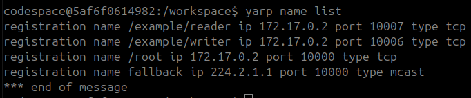

### 4. Pruebas y diagnóstico

* **`yarp ping /example/reader`**: comprueba que el puerto responde y muestra su información (dirección y conexiones). Para ello el puerto debe estar abierto.
* **`yarp read /example/reader`**: *ver Ejercicio 3*.
* **`yarp write /example/writer`** : *ver Ejercicio 3*.

### 5. Manipulación avanzada de puertos

* **`yarp write --anon`**: no parece funcionar. En la documentacion (https://www.yarp.it/latest/group__yarp.html#yarp_write) tampoco parece indicar la existencia de esta configuración.
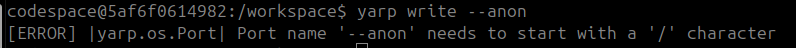

* **`yarp name register /my/port`**: reserva un nombre en el servidor de nombres. De nuevo, Yarp asigna un puerto distinto y secuencial dentro de la dicrección IP local.
* **`yarp name unregister /my/port`**: borra ese nombre del servidor de nombres.

### 6. Limpiar el estado del servidor de nombres

* **`yarp clean`**: revisa los puertos registrados y elimina los que ya no responden. En mi caso, ha borrado el puerto creado con yarp name register, que no estaba siendo usado, simplemente fue definidio.
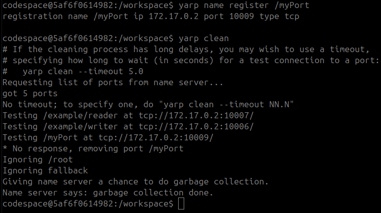

### 7. Redes distribuidas

* **`yarp check --remote <hostname>:<port>`**: parece ignorar los parámetros y simplemente hace un yarp check. Tampoco aparece en la documentación.
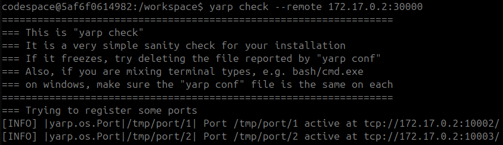


* **`yarp name reconfigure <port> <new-server>`**: no parece funcionar y tampoco aparece en la documentación.

### 8. Configuración básica de puertos desde la línea de comandos

(Comandos ejecutados previamente)

### Preguntas

* **¿Qué sucede si intentas enviar un mensaje antes de conectar los puertos?** Que el mensaje no llega a ninguna parte.
* **¿Cómo se desconectan los puertos desde la terminal?** Con yarp disconnect /sender /receiver.
* **Si creas un segundo lector `/receiver2` y lo conectas al escritor, ¿ambos reciben el mensaje?** Sí. Un puerto de salida envía una copia a cada conexión que tenga, así que /receiver y /receiver2 reciben el mismo mensaje.


## Ejercicios 2: Uso de Puertos en Yarp

Como el script del receiver no contiene un bucle como el sender, se puede observar que simplemente se ejecuta y capta un mensaje puntual antes de llegar a la instrucción de cerrar el puerto y terminar el programa.
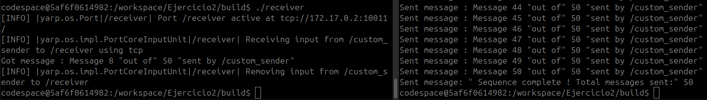

### Preguntas

* **¿Que sucede si los puertos no se conectan?** Que el mensaje no llega a ninguna parte, de forma similar a como pasaba por comando de terminal.
* **¿Cómo podrías modificar el nodo receptor para manejar múltiples mensajes con diferentes formatos?** Comprobando el posible tipo de cada elemento con get(i) y los métodos de Value (isString(), isInt32()... etc) según la documentacion en https://www.yarp.it/latest/classyarp_1_1os_1_1Value.html.


```cpp
// Leer los mensajes recibidos
bool fin = false;
while (!fin && input.read(bot)){
    for (size_t i = 0; i < bot.size(); i++){
        Value& v = bot.get(i);
        if (v.isString()) {
            std::cout << "[texto] " << v.asString() << std::endl;
            if (v.asString().find("Sequence complete") != std::string::npos)
                fin = true;
        }
        else if (v.isInt32()) std::cout << "[entero] " << v.asInt32() << std::endl;
    }
}
  ```

  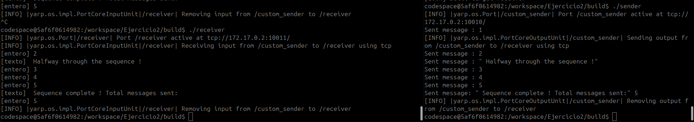

## 2.1. Conexión Directa entre Puertos en YARP

// de la clase: cuidado con el setStrict que tiene truco, mirar el manual

// del discord: no es necesario hacer los ejercicios 5 y 6, cuando se revise ROS 2 se volverá para comparar

